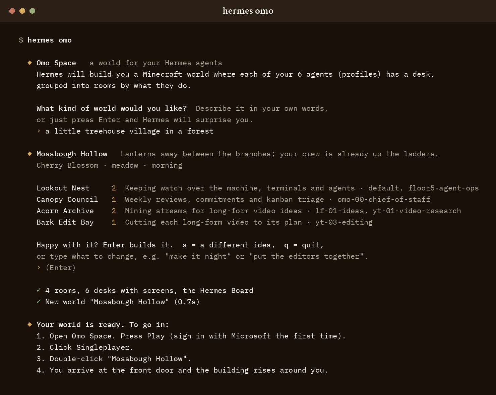

# Omo Space for Hermes

**Tell Hermes what kind of world you'd like. It designs a Minecraft world for your agents and builds it.**
Every Hermes profile gets a desk with a wall of screens, in rooms named for what your agents actually do.
In [Omo Space](https://github.com/omoresearch/omo-space) those screens are live: walk up to a desk,
right-click, and talk to that agent. A Hermes Board on the wall shows what every session is doing.

No Minecraft experience needed: the plugin tells you what to get, opens the game for you, and shows the
five keys you need.

<p align="center"></p>
<p align="center"><sub>A real run, unedited: one wish, a plan your own model designed from six profiles, one Enter.</sub></p>

## Quickstart

```bash
hermes plugins install omoresearch/hermes-omo-space --enable
hermes omo
```

That's it. `hermes omo` first **looks at your setup** and tells you what it found, in plain words:

```
  ◆ Your setup   (read-only: names and counts, no chats or keys)
    · 49 profiles: a fleet: departments, with quiet agents in their own corner.
    · 41 talk to people on discord.
    · 8 run scheduled jobs (33 in all).
    · 23 have been quiet for 30+ days: they get a quiet corner.
    · Shared specialities: creative-experiment-operations (7), meta-ad-library-research (6).

    Use your Hermes model to design it from this? Your own model and login; nothing is sent until you say yes.
    › [Y/n]
```

Say yes and your own model (the one Hermes already uses, with its existing login; no new key) designs a
world for **your** setup: agents that share skills sit together, chat-facing agents get their own room,
quiet ones go to a calm corner, one agent gets a single cosy room and a fleet gets departments. Say `n`
and the same audit plans the rooms without any model. `hermes omo create --audit` prints the exact text
the model would get.

Then it asks one question, **what kind of world would you like?** Describe it in your own words
("a little treehouse village in a forest") or just press Enter and Hermes surprises you. You see the plan
first, with **why** each room exists:

```
  ◆ Mossbough Hollow   Lanterns sway between the branches; your crew is already up the ladders.
    Forest Grove · forest floor · night

    Lookout Nest     2  Keeping watch over the machine and agents
                        why: both run the schedules (23 jobs)
                        default, floor5-agent
    Bark Edit Bay    3  Cutting each long-form video to its plan
                        why: all 3 share the video-editing skills
                        yt-01-video-research, yt-03-editing, lf-01-ideas

    Happy with it? Enter builds it.  a = a different idea,  q = quit,
    or type what to change, e.g. "make it night" or "put the editors together".
```

Press Enter and the world is made. It offers to **light up every desk** (one y/N: it enables omo-space in
the profiles that don't have it yet, so their screens go live), then tells you exactly how to get in,
offers to open the game for you, and shows the five keys you need:

```
  ◆ Your world is ready. To go in:
    1. Open Omo Space. Press Play (sign in with Microsoft the first time).
    2. Click Singleplayer.
    3. Double-click "Mossbough Hollow".
    4. The building rises around you as you arrive.

    Getting around (first time in Minecraft? this is all you need)
    W A S D      walk
    mouse        look around
    Space        jump (press twice to fly, you're in creative mode)
    right-click  use a desk's computer: talk to that agent
    Esc          pause, settings, or let go of the mouse
```

You can also just ask Hermes in any chat (Desktop, Telegram, ...): *"build me a world for my agents,
something cosy"*. The agent calls `omo_audit_setup` first, shows you what it found and asks, then
`omo_create_world` builds it.

### Never played Minecraft?

You need two things, both one-off:

1. **A Minecraft Java Edition account** (bought once from [minecraft.net](https://www.minecraft.net/)).
2. **Omo Space**, free: it brings its own Minecraft, so there is nothing else to set up
   ([install](https://github.com/omoresearch/omo-space#install)).

You can run `hermes omo` before either: the world is saved and waits, and `hermes omo open` shows the
steps again whenever you're ready. Worlds are always new folders; nothing you already have is touched.

**Already play Minecraft but not Omo Space?** It notices and builds for plain Minecraft 26.2 instead: the
same building, with dark glass where the live screens would be (`--for minecraft` to choose it).

Unattended: `hermes omo create "a forest studio" --yes` (or `--json`). No model? `--no-ai` plans rooms
from your profile names.

## Also included

<p align="center"></p>
<p align="center"><sub>The Hermes Board on the wall (demo workspaces): names and states only.</sub></p>

> Live Board activity and in-game notices need the feed-aware Omo bridge from
> [omo-space PR #40](https://github.com/omoresearch/omo-space/pull/40) (next Omo Space release); desks,
> screens and the Board wall work with Omo Space v1.3 today.

- A **metadata-only activity feed** per profile (event kinds, tool names, timings; never message text,
  tool arguments or results) that the Omo bridge reads for the Board. Nothing leaves your machine.
- Agent tools `omo_status` / `omo_notify`, the `/omo` slash command and `hermes omo status` (a doctor).
- `hermes omo setup` (checklist across profiles) and `hermes omo world` (Hermes HQ for a world you
  already have).

## Install Omo Space (v1.3)

Two ways in (full steps in Omo Space's [README](https://github.com/omoresearch/omo-space#install)):

- **The Omo Space app** sets up its own Minecraft, Fabric, the mods, the bridge and its services.
- **CurseForge, the Modrinth App or Prism:** add *Omo Space*, *CC: Tweaked* and (for web walls) *MCEF
  Modern* to an instance, then install only the bridge (Linux and macOS):

  ```bash
  bash install.sh --bridge-only omo-space-1.3.0-linux-x64.tar.gz   # bridge + session server, links your instances
  omo-space-link --game-dir "<instance folder>"                    # an instance added later
  ```

Open a world once so the bridge is running. In the creative menu the desk block is the **Omo Computer**
(same id as the old Hermes Computer, `omolife:hermes_computer`), next to the **Omo Monitor**.

## Adding Hermes HQ to a world you already have

`hermes omo setup` walks a checklist and asks before it changes anything:

1. Omo Space data dir and bridge: found via `OMO_PORT`, the Omo launcher's service file, or ports
   8780-8789 that belong to **your** user. If this profile points elsewhere it offers
   `hermes -p <profile> config set plugins.entries.omo-space.settings.bridge_url http://127.0.0.1:<port>`.
2. Profiles: shows every profile and whether omo-space is enabled. `hermes omo setup --enable-all`
   lists `hermes -p <profile> plugins enable omo-space` for each one and runs them after one y/N prompt.
3. World: offers to generate Hermes HQ and copy it into `<world>/datapacks/hermes_hq/`. Then in game:
   `/reload`, stand in an open flat area, `/function hermes_hq:preview`, `/function hermes_hq:build`.
   Right-click each desk's Omo Computer once: since Omo Space v1.3 a station only opens its workspace
   after its owner uses it.

Without a terminal (cron, gateway, CI) `hermes omo setup` just prints the checklist and exits 0.
The same steps by hand:

```bash
hermes omo status                                  # doctor: bridge, feed, next step
hermes omo world --list-worlds
hermes omo world --install "Omo World"             # --force replaces an earlier Hermes HQ, nothing else
hermes omo world --install "My World" --saves-dir "<instance folder>/saves"   # store (CurseForge/Modrinth/Prism) worlds
hermes omo world --out ./hermes-hq-datapack        # or just write the datapack somewhere
```

Then chat with Hermes anywhere.

## What you see

- **Omo Computer desks**, one per profile, the profile name on a plate. Opening one starts a Hermes tab in
  that profile (`hermes -p <profile> chat --tui`), kept by Omo Space's tmux server when you walk away.
- **Status lamps**: each desk's lamp glows gold while its agent or a command works, green when idle. Omo
  Space drives these itself.
- **The Hermes Board** (`/board`, on the wall in the hall): every tab with what its agent is doing,
  `thinking`, `running terminal 12s`, `idle · 3 turns`, compact cards past 24 live workspaces. *(PR #40)*
- **Elsewhere**: sessions with no desk (a Telegram chat on the gateway, a cron job, a plain terminal, a
  subagent) listed with their platform. *(PR #40)*
- **HUD notices**: an agent's `omo_notify` shows as a card top-left for about 5 s, up to three, only while no
  screen is open; an open station panel gets a toast. `/omonotices on|off|test` in game, or
  `hermesNotices=false` in `config/omolife-client.properties`. *(PR #40)*
- **The station splash**: before a desk connects it shows the Omo Space title card with the omo.sh mark.
  *(omo-space PR #41, next release)*

*(PR #40)* = needs the bridge from omoresearch/omo-space PR #40, coming in the next Omo Space release.

## Troubleshooting

| Symptom | Fix |
|---|---|
| `hermes omo status` says the bridge is **not yours** | On a shared machine port 8780 can be another user's Omo bridge; the plugin never queries it. Point this profile at yours: `hermes omo setup` finds it, or `hermes config set plugins.entries.omo-space.settings.bridge_url http://127.0.0.1:<port>`. |
| Board shows no Hermes activity, but `hermes omo feed` has events | Your Omo bridge predates Hermes feed support (`hermes omo status` says so). That support is in omoresearch/omo-space PR #40, coming in the next Omo Space release. |
| A desk says "Waiting for the world owner" | Omo Space v1.3: right-click the desk's Omo Computer (or its wall) once. |
| No notices in game | `/omonotices on`, then `/omonotices test`. They draw only while no screen is open, and need the PR #40 bridge. |
| Board shows activity but no messages | By design: `omo_notify` text stays off the wall Board unless the bridge service runs with `OMO_BOARD_MESSAGES=1`. |
| Board shows nothing and the feed is empty | The plugin is not enabled in that profile (`hermes omo setup` lists them), or `feed` is set to `false`. |
| Changes do not show up after updating the plugin | A running gateway keeps the plugin module it loaded. Run `hermes plugins disable omo-space` then `hermes plugins enable omo-space` (per profile) so it reloads. |
| `world --install` says the datapack already exists | Add `--force`; only `<world>/datapacks/hermes_hq/` is replaced. Run `/reload` in game afterwards. |
| Several worlds and `--install` refuses | Name one: `hermes omo world --install "<World>"` (`--list-worlds` shows them). |

## Reference

The plugin adds:

1. **A live activity feed.** Hooks write a small, metadata-only feed into this plugin's own data dir
   in the active profile. The feed-aware Omo bridge (omo-space PR #40) reads it to show what every
   agent is doing on the Hermes Board, list sessions that live outside the world (Telegram, cron, plain
   terminals, subagents) under *Elsewhere*, and turn `omo_notify` into HUD notices.
2. **Two agent tools** in toolset `omo`:
   - `omo_status`: read-only. Is Omo Space running, what is on the board, and where this conversation lives.
   - `omo_notify {text, level?}`: queue a short in-game notice (max 140 chars, redacted): a HUD card and
     a station toast.
3. **`/omo`**: a one-paragraph answer to "where is this conversation in the world?"
4. **`hermes omo`**:
   - `hermes omo` / `hermes omo create [WISH...] [--name] [--profiles|--exclude] [--no-ai] [--yes|--json]`:
     design a world with your model (via Hermes plugin LLM access: your active provider, host-owned auth)
     and write it as a new world folder with the Hermes HQ datapack inside. It never touches an existing world.
   - `hermes omo setup [--enable-all] [--non-interactive] [--json]`: the guided checklist above.
   - `hermes omo status [--json]`: a doctor. Checks the bridge on the configured URL, the feed dir and
     marker, the age of the last event, and which profiles on this machine have a feed, then gives one next step.
   - `hermes omo feed [-n N] [--json] [--follow]`: print or follow this profile's feed.
   - `hermes omo world [--install [WORLD] | --out DIR | --zip] [--list-worlds] [--dry-run] ...`:
     generate the *Hermes HQ* datapack (one Omo Computer desk per profile plus a Hermes Board wall).
     `--saves-dir` points `--install`/`--list-worlds` at a store instance's `saves/`.
     `--dry-run --json` prints the layout as data (bays, desks, stations, Board, regions); `worldgen.hall.Hall`
     gives the full block model for previews. In game the hall builds in a few staged ticks.

## Privacy and disclosure (what it does and does not do)

- **Network:** only plain-HTTP `GET /health` and `GET /board.json` to the Omo bridge on a
  **loopback** address (`127.0.0.1`, `localhost`, `::1`). Timeout 1.5 s. Environment proxies are
  ignored and redirects are refused, so nothing leaves the machine. A non-loopback `bridge_url`
  is refused. Hooks never touch the network. On Linux, before probing, the plugin reads
  `/proc/net/tcp` and `/proc/net/tcp6` to check that the process listening on the bridge port belongs
  to you; if another user's Omo bridge owns the port it is reported as "not yours" and never queried.
- **The setup audit** (`hermes omo` / `create`, `omo_audit_setup`) is read-only and sends nothing anywhere.
  Per profile it reads `profile.yaml` (description), `config.yaml` (model, enabled platform names, plugin
  names), `cron/jobs.json` (job count), the names of skill folders (SKILL.md is never opened) and, from
  `state.db` opened **read-only**, one aggregate query: `SELECT source, COUNT(*), MAX(started_at) FROM
  sessions GROUP BY source`. No message, title, prompt or other column is read. A Hermes without that table
  falls back to the newest mtime in `sessions/` (stat only).
- **The world designer** (only after you say yes at the prompt) sends your wish plus the audit summary to
  **your own active model** through Hermes' `ctx.llm` (no keys handled by the plugin): profile names,
  descriptions, chat platform names, job and session counts, skill names and days since last use.
  `hermes omo create --audit` prints the exact text. Never chats, memories, SOUL files, config values or
  secrets. Answering `n`, or `--no-ai`, designs from the audit without any model.
- **Opening the game** (`hermes omo open`, or after a build) starts the Omo Space app or the Minecraft
  Launcher only after you answer yes at a terminal; never from the agent tool or without a terminal.
- **No telemetry, no accounts, no secrets.** Nothing is reported anywhere; there is nothing to opt into.
- **Reads outside its own dir:** `hermes omo setup` reads each profile's `plugins.enabled` /
  `plugins.disabled` and plugin dir names (to show where omo-space is on), the Omo launcher's service
  file (`omo-bridge.service` + drop-ins, or the launchd plist) for `OMO_PORT`, and lists world folders
  in the Omo saves dir. `hermes omo status` lists which profiles have an omo-space feed
  (globbing `<root>/profiles/*/plugin-data/*/feed/omo-feed.json`). `hermes omo world` (only when you
  run it) reads, for every profile under your Hermes root: `profile.yaml` (display name/description),
  `config.yaml` (only model name/provider, enabled platform names and enabled plugin names are kept),
  `cron/jobs.json` (job count only), plugin dir names and SKILL.md file names (never opened). It never
  opens `.env`, `auth.json`, memories, logs or session files; `state.db` only read-only, as above.
- **Writes:** only its own profile-scoped dir, `<HERMES_HOME>/plugin-data/<namespace>/feed/`
  (dir `0700`, files `0600` on Linux/macOS; on Windows the profile dir's per-user ACL applies).
  `hermes omo world` writes only to the output path you give it; `hermes omo world --install` writes
  only `<world>/datapacks/hermes_hq/` (refuses to replace it without `--force`, never touches any
  other datapack).
- **Runs commands only when you say yes:** `hermes omo setup` may run `hermes -p <profile> config set
  plugins.entries.omo-space.settings.bridge_url ...` and, with `--enable-all`, `hermes -p <profile>
  plugins enable omo-space` (or `plugins install ... --enable` where it is not installed yet), each
  batch only after a y/N prompt at an interactive terminal. Under cron, the gateway, a pipe or CI it
  only prints the checklist and exits 0; it never prompts or blocks. It never edits `config.yaml` itself.
- **Records metadata only:** event kinds, tool *names*, counters, durations, timestamps, model and
  platform names, API status codes, kanban task ids, and the three Omo ids `OMO_WORKSPACE`,
  `OMO_TAB` and `OMO_HERMES_TITLE`. Never message text, tool arguments, tool results, error
  messages, kanban summaries or subagent goals. The one exception is `omo_notify` text, which has
  control characters stripped, anything that looks like a secret masked, and is capped at 140 characters.
- **On the Board (bridge side, omo-space PR #40):** `/board.json` carries status only: per agent profile,
  platform, state, tool name, tool time, turns, age, workspace name and whether it is elsewhere. No session
  ids, pids, models, titles or tool history. The text of `omo_notify` messages is off the wall Board unless
  the bridge service runs with `OMO_BOARD_MESSAGES=1`. HUD notices draw only on your own screen
  (`/omonotices off` hides them, e.g. on stream). Nothing from the feed is written into world data.
- **Never:** reads secrets or credential files, approves or blocks tools (`pre_tool_call` always
  returns `None`), injects context, patches Hermes, or touches a running game or bridge. Hooks and
  tools start no processes or threads. The `hermes omo` command starts a process only after you answer
  yes at a terminal (see above), and draws its progress spinner on a short-lived thread.
- **Cost:** every hook is a dict update plus at most one small atomic write and one append. Hooks
  catch every exception. After a filesystem error the writer pauses for 30 s instead of retrying on every call.

## Settings

Set these in `plugins.entries.omo-space.settings` (the Desktop settings form shows them too):

| key | type | default | meaning |
|---|---|---|---|
| `feed` | bool | `true` | Write the activity feed. |
| `bridge_url` | str | `""` | Empty means `http://127.0.0.1:$OMO_PORT`, or `8780` if `OMO_PORT` is unset. Loopback only. |
| `notify_on_finish` | bool | `false` | Queue a notice when a turn that took more than 60 s ends. |

Settings are read live: a `hermes config set plugins.entries.omo-space.settings.<key> ...` takes
effect on the next tool call, `/omo` or `hermes omo` run (hooks pick up `feed` /
`notify_on_finish` within 5 s), without restarting a long-lived plugin host.

## Feed format (v1)

The full contract is in `CONTRACT.md` next to this repo. In short:

- `omo-feed.json`: marker `{"v":1,"plugin":"omo-space","plugin_version","profile","updated"}`.
- `sessions/<session_id>.json`: one presence snapshot per session, replaced atomically and throttled
  to at most 4 writes/s unless the state changes. `ended` snapshots older than 24 h are pruned and the
  dir is capped at 200 files.
- `events.jsonl`: append-only, rotated to `events.1.jsonl` at 512 KiB (one generation kept).

How Hermes hooks map to the feed:

| Hermes hook | feed |
|---|---|
| `on_session_start` | `session_start`, state `idle` |
| `pre_llm_call` | `turn_start`, state `thinking` |
| `pre_tool_call` / `post_tool_call` | `tool_start` / `tool_end` (`tool`, `duration_ms`, `ok`) |
| `on_session_end` (fires after **every** turn) | `turn_end` (`ok`, `interrupted`, `duration_ms`), state `idle` (or `error`) |
| `on_session_finalize` (real teardown: `/new`, quit, gateway reset) | `session_end`, state `ended` |
| `subagent_start` / `subagent_stop` | child presence with `parent_session_id`; child `session_end` |
| `kanban_task_*` | `kanban_claimed/completed/blocked`, plus `kanban` on the process's active session |
| `post_compaction`, `api_request_error` | `compaction`, `api_error` (`status_code`) |

**Session identity in tool hooks.** Tool hooks receive `task_id` and, on current Hermes, also
`session_id`. In the interactive CLI and the gateway `task_id` equals the session id. In a
`delegate_task` child, `task_id` is the subagent id and `session_id` is the child agent's own
session. A one-shot run without a task id gets a fresh uuid per turn. The plugin therefore uses the
`session_id` kwarg and falls back to `task_id`.

Cron jobs never finalize their session, so their last snapshot stays `idle` until the bridge
treats it as stale (15 min, or when the pid is dead).

## Compatibility

- **Hermes:** v0.21.6 or newer (`requires_hermes: ">=0.21.6"`), tested on v0.21.6, v0.22.0, v0.22.2,
  v0.22.3 and v0.23.1. On a Hermes older than v0.22.3 the `post_compaction` hook does not exist, so it
  is skipped at load and the Board just shows no compaction events; everything else is the same.
- **Omo Space:** v1.3 for desks (the Omo Computer), lamps and the Board wall; the bridge from omo-space
  PR #40 (next release) for Board activity, Elsewhere and HUD notices. `tests/test_contract_pr40.py` reads
  this plugin's feed with that bridge's own reader.
- **OS:** Linux, macOS and Windows. The other-user port check reads `/proc/net` and only runs on
  Linux; elsewhere it is skipped. Omo data dirs follow Omo Space's `docs/PLATFORMS.md`:
  `~/.local/share/omo`, `~/Library/Application Support/OmoResearch`, `%LOCALAPPDATA%\OmoResearch`
  (`OMO_DATA` overrides). Stdlib only, Python 3.11+.

## Development

```bash
pip install -r tests/requirements.txt   # pytest only; the plugin itself is stdlib-only
python -m pytest -q
hermes plugins validate .
hermes plugins doctor . --ci
```

License: MIT, © Omo Research.
